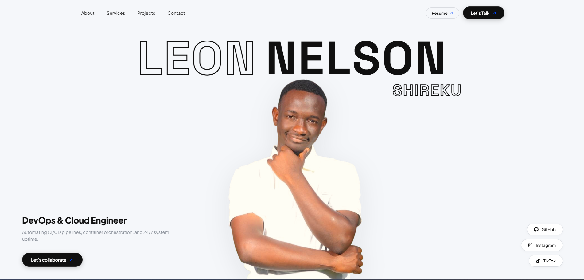

# ⚡ Leon Nelson — Full-Stack Software Engineer & Digital Strategist

[](https://leonshireku.me/)
[](https://leonshireku.me/)
[](https://leonshireku.me/llms.txt)

A high-performance, modern portfolio engineered with React, Vite, and bespoke CSS architecture. Designed with a luxury editorial aesthetic, interactive micro-animations, and full-spectrum search engine & AI agent discoverability.

---

## 📸 Portfolio Preview

<div align="center">
  
</div>

---

## 🌟 Key Features & Architecture

### 1. 🔠 Character Staggered Blur & Scramble Reveal
- Custom character-by-character unblur animation using CSS variables (`--char-index`), hardware-accelerated transforms, and Gaussian blurs (`filter: blur(14px) → blur(0px)`).
- On page load and interactive hover, letters dynamically cycle through cryptographic tech glyphs (`01#X_@$8&*`) before snapping into razor-sharp typography.
- Fully accessible via semantic `<h1>` with `aria-label` for screen readers and AI crawlers.

### 2. 🎰 Kinetic Role Slot-Machine Reel
- Automatically rolls through core disciplines every 3.2s with cubic-bezier easing:
  - *Full-Stack Software Engineer*
  - *DevOps & Cloud Engineer*
  - *Social Media Manager*
  - *Digital Marketer & SEO Specialist*
- Synchronized with dual-viewport bio descriptions and direct collaboration CTAs.

### 3. 📖 Editorial Case Studies & Architecture Deep-Dives
- **Supreme Adventures**: Custom East African safari booking engine & private staff portal. Ranked on Google to drive direct international travelers with zero recurring CMS subscriptions.
- **Lulu Aurelian Estate**: Luxury vacation rental platform featuring automated M-Pesa STK push payments, instant smart door lockbox code delivery, and live property management dashboards.
- Interactive modal case study viewer featuring technical architecture breakdowns, problem-solution matrices, and video previews.

### 4. 🚀 Performance & Core Web Vitals
- **Next-Gen Image Formats**: Assets converted to Lanczos-resampled WebP (saving over 2,600 KiB across mockups and portraits).
- **Sub-Second LCP**: Hero portrait preloaded via `<link rel="preload" as="image" fetchpriority="high">`.
- **Zero Layout Shift (0.00 CLS)**: Explicit dimensions and aspect-ratio reservation across all media.
- **Render-Blocking Free**: Eliminated font `@import` latency by preconnecting Google Fonts with `&display=swap`.

### 5. 🤖 Search Engine Optimization & Agentic Web (4/4 Score)
- **Semantic Prerender Shell**: Statically prerendered HTML snapshot directly inside `<div id="root">` ensures non-JS bots, Googlebot Wave 1, Bingbot, and social crawlers index all headings, case studies, and contact info immediately.
- **Structured Data (JSON-LD)**: Schema.org `Person` and `WebSite` entities for Google Knowledge Graph inclusion.
- **AI Agent Discoverability**:
  - `llms.txt` & `.well-known/llms.txt` conforming to the [llmstxt.org](https://llmstxt.org/) specification.
  - `ai-catalog.json` conforming to the **Agentic Resource Discovery (ARD 1.0)** standard.
- **Social Graph Protocol**: OpenGraph and Twitter/X cards linked to verified portrait metadata (`/picha.png`).

---

## 🛠️ Tech Stack

| Layer | Technologies |
| :--- | :--- |
| **Frontend Core** | React 18, JSX, JavaScript (ESNext) |
| **Build & Tooling** | Vite, PostCSS, ESLint |
| **Styling & Motion** | Vanilla CSS3 (Custom Tokens), AOS (Animate On Scroll), Keyframe Physics |
| **Icons & Typography** | React Icons (`fa6`, `si`, `fi`), Space Grotesk, Plus Jakarta Sans |
| **SEO & Discovery** | Schema.org JSON-LD, ARD 1.0 (`ai-catalog.json`), `llms.txt`, OpenGraph |

---

## 📂 Project Structure

```bash
Leon-Nelson/
├── public/
│   ├── .well-known/            # ARD ai-catalog.json and llms.txt discovery
│   ├── projects/               # WebP mockups & demo video previews
│   ├── services/               # Optimized service category previews
│   ├── ai-catalog.json         # Agentic Resource Discovery manifest
│   ├── llms.txt                # LLM markdown documentation index
│   ├── picha.webp / picha.png  # Hero portrait & social share media
│   ├── projectscreenshot.png   # Full portfolio visual preview
│   ├── robots.txt              # Search engine crawler directives
│   └── sitemap.xml             # Canonical sitemap protocol
├── src/
│   ├── assets/                 # Shared data sets & branding assets
│   ├── components/
│   │   ├── About/              # Narrative, CV access & tech stack grid
│   │   ├── Contact/            # Cloud stage, direct inquiry & channels
│   │   ├── Footer/             # Brand footer, copyright & social links
│   │   ├── Hero/               # Typography scramble, wheel reel & portrait
│   │   ├── services/           # Interactive accordion service cards
│   │   ├── Work/               # Case studies, modal spread & video preview
│   │   └── navbar.jsx          # Sticky glassmorphism desktop & mobile nav
│   ├── App.jsx                 # Root application wrapper & AOS init
│   ├── index.css               # Global tokens, color system & reset
│   └── main.jsx                # React DOM entry point
├── index.html                  # SEO metadata, JSON-LD & prerender shell
└── package.json
```

---

## ⚡ Getting Started Locally

### Prerequisites
- Node.js (v18 or higher recommended)
- npm or yarn

### Installation
```bash
# 1. Clone repository
git clone https://github.com/leonokumu254/Leon-nelson.git
cd Leon-nelson

# 2. Install dependencies
npm install

# 3. Start local development server
npm run dev
```

### Production Build & Preview
```bash
# Build optimized production bundle to /dist
npm run build

# Preview production build locally
npm run preview
```

---

## 📬 Contact & Collaboration

- **Live Website**: [leonshireku.me](https://leonshireku.me/)
- **Email**: [leonshireku@gmail.com](mailto:leonshireku@gmail.com)
- **Phone / WhatsApp**: [+254 741 766 710](https://wa.me/254741766710)
- **GitHub**: [@leonokumu254](https://github.com/leonokumu254)
- **TikTok**: [@nelson_leon6](https://www.tiktok.com/@nelson_leon6?is_from_webapp=1&sender_device=pc)
- **Instagram**: [@leon.nelson.121](https://www.instagram.com/leon.nelson.121)
- **Resume / CV**: [Google Docs Curriculum Vitae](https://docs.google.com/document/d/1ysB4CDrRh2jZUjOp3PFblqdg8njHe-kTuuGXMdi2ZNQ/edit?usp=sharing)

---

&copy; 2026 Leon Nelson. All rights reserved.
